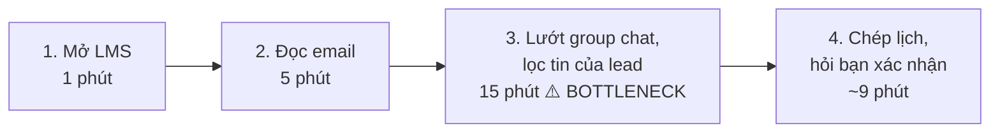
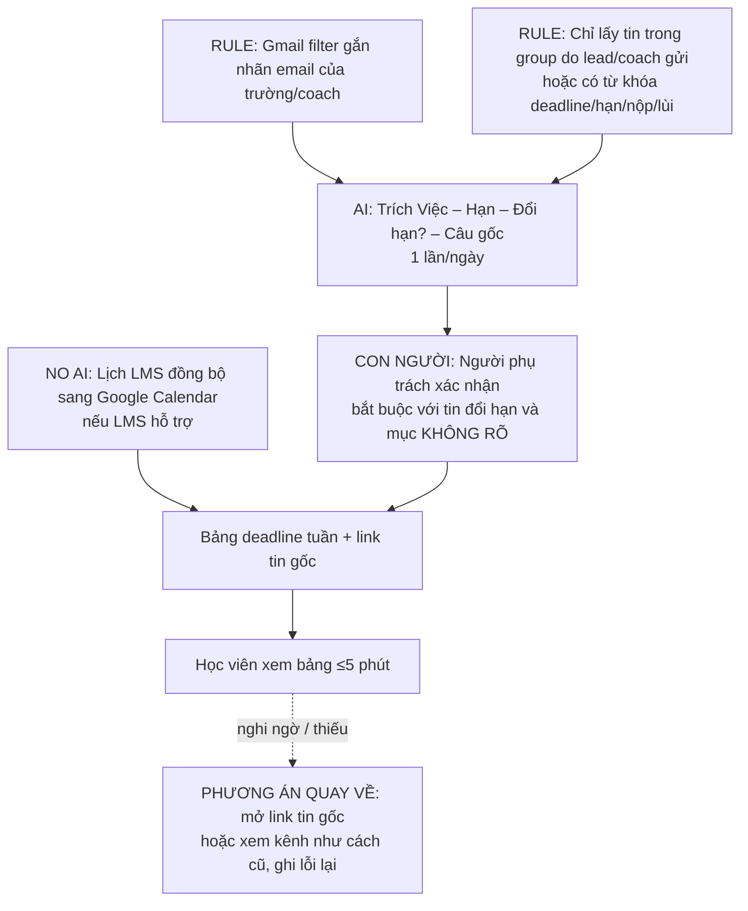

# Báo cáo nhóm — Day 02 Discovery & Problem Framing

> Bản chung của nhóm, viết trên repo do nhóm trưởng fork. Không copy file này sang repo cá nhân.
> Template chi tiết và prompt mẫu: [docs/01-worksheet.md](../../docs/01-worksheet.md). Bài mẫu: [docs/02-deliverable-example.md](../../docs/02-deliverable-example.md).
>
> Chỗ ghi `⟨CẦN ĐIỀN⟩` là dữ liệu thật mà nhóm phải tự bổ sung (pitch của từng thành viên, kết quả phỏng vấn). Xóa ghi chú này khi xong.

## 1. Thông tin nhóm

- Tên nhóm: C2
- Thành viên: xem `TEAM.md`
- Candidate problem được chọn (1 câu): Học viên mất ~30 phút/ngày dò LMS, email và group chat để biết deadline, vì thông báo chính thức của lead/coach bị lẫn giữa rất nhiều tin hỏi đáp của học viên.
- Quyết định cuối: **Not Yet** (xem mục 8)

---

## 2. Hội tụ nhóm (CP3)

### 2.1. Pitch

| # | Người đưa ra | Candidate (Job Story ngắn) | Actor | Bottleneck | Câu hỏi phản biện nhận được (ai hỏi) |
|---:|---|---|---|---|---|
| 1 | Phùng Thị Nhài | Khi thông báo deadline nằm rải rác ở LMS, email, group chat, tôi muốn biết chắc tuần này phải nộp gì, để không phải lúc nào cũng lo bỏ sót | Học viên lớp ~85 người | Lọc tin của lead giữa tin hỏi đáp trong group chat (~15/30 phút mỗi ngày) | ⟨CẦN ĐIỀN: câu hỏi — người hỏi⟩ |
| 2 | Phùng Thị Nhài | Khi làm báo cáo nhóm, tôi muốn gom phần của mọi người vào một file thống nhất định dạng, để nộp đúng hạn | Người tổng hợp báo cáo nhóm | Ghép + sửa định dạng (~12/20 phút mỗi lần, ~15 lần/tháng) | ⟨CẦN ĐIỀN⟩ |
| 3 | Phùng Thị Nhài | Khi cần tìm lại file/link cũ trong group chat, tôi muốn tìm ra trong vài giây, để không phải hỏi lại cả nhóm | Thành viên nhóm học tập | Kéo ngược lịch sử chat (2–3 phút/lần, 20–30 lần/tuần) | ⟨CẦN ĐIỀN⟩ |
| 4 | ⟨Thành viên 2⟩ | ⟨CẦN ĐIỀN⟩ | | | |
| 5 | ⟨Thành viên 2⟩ | ⟨CẦN ĐIỀN⟩ | | | |
| 6 | ⟨Thành viên 2⟩ | ⟨CẦN ĐIỀN⟩ | | | |
| 7 | ⟨Thành viên 3⟩ | ⟨CẦN ĐIỀN⟩ | | | |
| 8 | ⟨Thành viên 3⟩ | ⟨CẦN ĐIỀN⟩ | | | |
| 9 | ⟨Thành viên 3⟩ | ⟨CẦN ĐIỀN⟩ | | | |

### 2.2. Cluster

| Cluster | Các candidate | Pattern chung |
|---|---|---|
| A — Quá tải thông tin từ nhiều kênh | #1, #3, ⟨candidate của bạn khác nếu cùng pattern⟩ | Thông tin quan trọng bị chìm trong nhiều kênh/tin nhắn, phải dò thủ công |
| B — Phối hợp làm việc nhóm | #2, ⟨…⟩ | Tốn thời gian ghép, chờ, đồng bộ giữa các thành viên |
| C | ⟨CẦN ĐIỀN⟩ | |

### 2.3. Opportunity Solution Tree rút gọn

Gốc là **1 outcome**. Nhánh là **opportunity** (nhu cầu, pain), không phải tính năng hay công cụ.

```text
OUTCOME: Học viên nắm đủ việc cần làm và hạn nộp mà tốn ít thời gian dò tin
├── Opportunity A: Thông báo chính thức bị lẫn giữa tin hỏi đáp của học viên
├── Opportunity B: Phải kiểm tra nhiều cổng (LMS, email, group chat) mỗi ngày
└── Opportunity C: Không chắc thông tin mình có là mới nhất (đổi hạn) → phải hỏi lại bạn bè
```

Những ý đã gạch bỏ vì là solution đội lốt opportunity:

- ~~"Thiếu một AI tổng hợp email và LMS"~~ → đây là giải pháp; pain thật là "mất 30 phút/ngày và luôn sợ bỏ sót"
- ~~"Cần app nhắc deadline"~~ → giải pháp, không phải nhu cầu

### 2.4. Chấm điểm shortlist (1–5)

| Candidate | Actor rõ | Quy trình rõ | Pain có bằng chứng | Impact đo được | Vừa sức lab | So sánh được No AI/Rule/Workflow/Agent | Nhóm hiểu domain | Tổng |
|---|---:|---:|---:|---:|---:|---:|---:|---:|
| #1 Deadline rải rác nhiều kênh | 5 | 5 | 3 | 4 | 5 | 5 | 5 | 32 |
| ⟨Candidate 2⟩ | | | | | | | | |
| ⟨Candidate 3⟩ | | | | | | | | |

**Candidate được chọn:** #1 — Deadline và thông báo nằm rải rác ở LMS, email, group chat.

**Vì sao chọn:** Cả nhóm đều là học viên nên hiểu domain; quy trình vẽ được rõ (4 bước, có số phút); impact đo được (30 phút/ngày, hỏi bạn ~4 lần/tuần); so sánh được đủ 4 mức can thiệp vì có phương án No AI rõ ràng (kênh thông báo riêng).

**Vì sao loại các candidate còn lại:**
- #2 Gom báo cáo nhóm: mỗi lần chỉ ~20 phút, giải được bằng template chung (No AI), không đủ để so sánh các mức AI.
- #3 Tìm lại thông tin trong group chat: phần lớn giải được bằng tính năng ghim/tìm kiếm sẵn có + 1 file "Tài nguyên nhóm".
- ⟨CẦN ĐIỀN: lý do loại candidate của các bạn khác⟩

**Xử lý bất đồng (nếu có):** ⟨CẦN ĐIỀN, hoặc ghi "Không có"⟩

---

## 3. Kiểm chứng + research giải pháp đã có (CP4)

### 3.1. Assumption Map

| # | Giả định | Loại (Value / Usability / Feasibility / Viability) | Quan trọng (1–5) | Đã có bằng chứng (1–5) | Kiểm chứng trước? |
|---:|---|---|---:|---:|---|
| 1 | Nhiều học viên khác (không chỉ người đề xuất) mất ≥15 phút/ngày dò thông báo deadline | Value | 5 | 1 | **Có** |
| 2 | Phần tốn thời gian nhất là lọc tin của lead giữa tin hỏi đáp trong group chat | Value | 5 | 2 | **Có** |
| 3 | Học viên thường phải hỏi lại bạn bè để xác nhận deadline | Value | 4 | 2 | Có |
| 4 | Thông báo của lead viết tự do, Rule theo từ khóa không bắt đủ | Feasibility | 4 | 1 | Có (thử với 20 tin thật) |
| 5 | Có người (lớp trưởng/học viên) sẵn sàng dành ~10 phút/ngày xác nhận bảng deadline | Viability | 4 | 1 | Sau |
| 6 | Lead/coach đồng ý cho dùng nội dung group chat để tổng hợp | Viability | 3 | 1 | Sau |

Giả định nhóm kiểm chứng trong buổi này: **#1 và #2** (quan trọng nhất, ít bằng chứng nhất — hiện chỉ có dữ liệu của 1 người).

### 3.2. Kiểm chứng

Cách đã dùng: ⟨CẦN ĐIỀN: Phỏng vấn / Survey⟩

Câu hỏi phỏng vấn (theo The Mom Test — hỏi hành vi đã xảy ra, không hỏi ý tưởng):
1. Lần gần nhất bạn kiểm tra deadline là khi nào? Bạn mở những kênh nào, theo thứ tự nào?
2. Hôm qua bạn mất khoảng bao lâu cho việc đó?
3. Tuần này bạn có phải hỏi ai về hạn nộp không? Chuyện gì đã xảy ra?
4. Có lần nào bạn suýt lỡ hoặc hiểu sai một thông báo không? Kể lại.
5. Hiện bạn làm gì để không bỏ sót (ghim, ghi chú, bật thông báo…)?

Interview snapshot (mỗi buổi phỏng vấn một bảng, hoặc đặt file trong `report/assets/cp4-interview-snapshot-N.md`):

| Trường | Nội dung |
|---|---|
| Người được hỏi (vai trò, không ghi tên thật) | ⟨CẦN ĐIỀN, vd. "Học viên L3B, nhóm khác"⟩ |
| Câu nói đáng nhớ nhất (nguyên văn) | ⟨CẦN ĐIỀN⟩ |
| Lần gần nhất gặp vấn đề này: chuyện gì đã xảy ra? | ⟨CẦN ĐIỀN⟩ |
| Hiện đang xử lý bằng cách nào (workaround)? | ⟨CẦN ĐIỀN⟩ |
| Mất bao lâu, bao lần? | ⟨CẦN ĐIỀN⟩ |
| Insight / opportunity rút ra | ⟨CẦN ĐIỀN⟩ |

Tổng hợp:

| Nguồn | Số người / số mẫu | Tín hiệu xác nhận | Tín hiệu phản bác |
|---|---:|---|---|
| Người đề xuất (tự ghi nhận) | 1 | 30 phút/ngày; hỏi bạn ~4 lần/tuần; luôn lo bỏ sót | Chưa lỡ deadline nào; lớp đã có kênh thông báo riêng (ít được dùng) |
| Phỏng vấn | ⟨CẦN ĐIỀN⟩ | ⟨CẦN ĐIỀN⟩ | ⟨CẦN ĐIỀN — bắt buộc có ít nhất 1⟩ |

**Nhóm đã sửa problem thế nào sau kiểm chứng:**
- Đã sửa (từ phản biện): pain không phải "lỡ deadline" mà là **tốn thời gian + phụ thuộc bạn bè + lo bỏ sót** → metric đổi sang số phút/ngày và số lần hỏi bạn.
- Đã sửa: bottleneck không phải "thiếu thông tin" mà là **thông báo chính thức bị lẫn giữa tin hỏi đáp**.
- ⟨CẦN ĐIỀN: thay đổi sau phỏng vấn⟩

### 3.3. Research giải pháp đã có

| Công cụ / case / pattern | Link | Giải bước nào trong quy trình? | Điểm mạnh | Khoảng trống / rủi ro | Bài học cho nhóm |
|---|---|---|---|---|---|
| Bộ lọc Gmail (filter theo tiêu chí tìm kiếm) | https://support.google.com/mail/answer/6579 | Bước 2 — lọc email theo người gửi/từ khóa, gắn nhãn tự động | Miễn phí, có sẵn, là Rule thuần | Chỉ cho email, không đọc group chat; không hiểu nội dung (đổi hạn) | Bước email giải được bằng **Rule**, không cần AI |
| Google Calendar — thêm lịch từ URL | https://support.google.com/calendar/answer/37100 | Bước 1, 4 — gom lịch từ nguồn khác (nếu LMS có link lịch) vào một chỗ | Có sẵn, tự cập nhật | Chỉ thêm được lịch công khai/có link; LMS của lớp có xuất lịch không thì ⟨CẦN KIỂM TRA⟩ | Nếu LMS xuất được lịch, bước LMS gần như tự động — **No AI** |
| Gemini trong Gmail (tóm tắt email) | https://support.google.com/mail/answer/14199860 | Bước 2 — tóm tắt chuỗi email, liệt kê việc cần làm | Đã có AI tóm tắt sẵn trong Gmail | Cần gói Google Workspace/AI đủ điều kiện; không đọc group chat Zalo/Discord | Phần AI cho email **đã có sẵn trên thị trường** → nhóm không nên tự xây; khoảng trống thật nằm ở **group chat** |

> Mỗi link trên đã được mở và kiểm nội dung ngày 2026-11-10. Thành viên nhóm nên tự mở lại trước khi nộp.

**Kết luận research:** Bước LMS và email đã có công cụ giải (Rule/No AI). Khoảng trống còn lại là **bước 3 — group chat**, nơi thông báo viết tự do và bị lẫn với tin hỏi đáp.

---

## 4. Quy trình trước/sau (CP5)

### 4.1. Quy trình hiện tại



| Bước | Actor | Input | Output | Thời gian / tần suất | Ghi chú |
|---:|---|---|---|---|---|
| 1 | Học viên | Trang bài tập trên LMS | Danh sách bài tập + hạn trên LMS | 1 phút/ngày | Thông tin rõ ràng nhưng không đủ (đổi hạn thường báo ở group) |
| 2 | Học viên | Hộp thư email trường | Thông báo từ trường/coach | 5 phút/ngày | Lẫn với email không liên quan |
| 3 | Học viên | Group Zalo/Discord lớp (~85 người) | Thông báo của lead/coach | 15 phút/ngày (ước lượng) | **Bottleneck**: tin của lead bị chìm giữa câu hỏi học viên |
| 4 | Học viên + bạn bè | Thông tin từ bước 1–3 | Lịch/ghi chú cá nhân | ~9 phút/ngày; hỏi bạn ~4 lần/tuần | Phụ thuộc bạn bè để xác nhận |

**Bottleneck chính:** Bước 3 — lọc thông báo chính thức của lead/coach ra khỏi tin hỏi đáp trong group chat, ~15 phút/ngày (một nửa tổng thời gian).

### 4.2. Quy trình tương lai



- **Rule:** lọc email (Gmail filter), lọc tin group theo người gửi/từ khóa.
- **AI:** chỉ trích thông tin từ tin đã lọc (việc, hạn, có phải đổi hạn không, câu gốc).
- **Con người:** người phụ trách (luân phiên) xác nhận trước khi đưa lên bảng; học viên tự mở tin gốc khi nghi ngờ.
- **Boundary:** AI không tự quyết hạn khi tin không rõ, không xóa/bỏ qua tin, không trả lời trong group.
- **Phương án quay về:** nếu bảng thiếu/sai → học viên mở link tin gốc hoặc xem kênh như cũ; lỗi được ghi lại để sửa Rule/prompt.

### 4.3. Before / after

| Chỉ số | Trước | Sau (kỳ vọng) | Ghi chú |
|---|---:|---:|---|
| Số bước (phía học viên) | 4 | 1–2 | Xem bảng; mở tin gốc khi nghi ngờ |
| Tổng thời gian (học viên) | ~30 phút/ngày | ≤ 5 phút/ngày | Cần đo lại bằng log |
| Số bước thủ công | 4 | 2 (người xác nhận + học viên xem bảng) | |
| Bottleneck chính | Lọc tin lead trong group chat (15 phút) | Người xác nhận bảng (~10 phút/ngày, 1 người cho cả lớp) | Dời việc từ 85 người sang 1 người |
| Rủi ro mới phát sinh | — | AI bỏ sót/sai hạn; học viên tin bảng mà không kiểm tra; dồn việc lên người xác nhận; quyền riêng tư tin nhắn lớp | Xử lý bằng boundary + link tin gốc |

---

## 5. Problem Statement v0 (CP5)

| Trường | Nội dung |
|---|---|
| **Actor** | Học viên một lớp ~85 người, học nhiều môn/khóa cùng lúc |
| **Quy trình** | Mỗi ngày mở LMS (1') → email (5') → group chat (15') → chép lịch, hỏi bạn xác nhận (~9') |
| **Bottleneck** | Lọc thông báo chính thức của lead/coach ra khỏi tin hỏi đáp của học viên trong group chat (~15 phút/ngày) |
| **Impact** | ~30 phút/ngày (~3,5 giờ/tuần) mỗi học viên; luôn lo bỏ sót; hỏi bạn bè ~4 lần/tuần để xác nhận |
| **Success Metric** (baseline → target, cách đo) | Thời gian kiểm tra deadline: 30 → ≤ 5 phút/ngày; số lần hỏi bạn về hạn nộp: ~4 → ≤ 1 lần/tuần. Đo bằng log tự ghi 1 tuần trước và 2 tuần pilot |
| **Boundary** (AI không được làm gì; khi nào cần con người kiểm tra — HITL) | AI không được tự quyết hạn khi tin không ghi rõ, không xóa/bỏ qua tin, không đăng/trả lời trong group. Con người phải kiểm tra: mọi tin **đổi hạn**, mọi mục **KHÔNG RÕ**, và trước khi bảng được gửi cho lớp |

Phản biện nhận được (từ AI hoặc nhóm khác) và nhóm có đồng ý không:

- "Metric 30 phút là ước lượng của 1 người" → Đồng ý; cần log 1 tuần và phỏng vấn để có baseline thật.
- "Lớp đã có kênh thông báo riêng, sao không bắt buộc dùng?" → Đồng ý một phần; giữ làm phương án No AI, nhưng đã thử mà không hiệu quả vì phụ thuộc thói quen người đăng.
- "Bottleneck chuyển sang người xác nhận" → Đồng ý; bổ sung vào Problem Statement v1 (rủi ro & người kiểm tra).

---

## 6. Mức can thiệp AI (CP6)

### 6.1. Ma trận độ mơ hồ × độ phức tạp

Bài của nhóm nằm ở ô: **Độ mơ hồ trung bình × Độ phức tạp thấp**

Vì sao: Các bước cố định, lặp lại mỗi ngày (phức tạp thấp). Nhưng thông báo viết tự do ("lùi sang CN", "như cũ nhé") nên cần hiểu ngôn ngữ, Rule thuần không bắt hết (mơ hồ trung bình).

### 6.2. So sánh 4 mức

| Mức | Phương án cho bài của nhóm | Đủ khi nào | Rủi ro | Chọn? |
|---|---|---|---|---|
| **No AI** (sửa quy trình) | Bắt buộc lead chỉ đăng thông báo ở kênh riêng; đồng bộ lịch LMS sang Google Calendar | Lead luôn tuân thủ | Lớp đã có kênh riêng nhưng ít dùng → phụ thuộc thói quen | Giữ làm nền + phương án quay về |
| **Rule** | Gmail filter; lọc tin group theo người gửi + từ khóa | Thông báo viết theo mẫu rõ ràng | Bỏ sót tin viết tự do, tin đổi hạn, tin coach được học viên trích lại | Dùng cho bước lọc |
| **Workflow** | Rule lọc → AI trích Việc/Hạn/Đổi hạn/Câu gốc → người xác nhận → bảng tuần | Thông báo viết tự do, cần hiểu nội dung | AI sai/bỏ sót; cần người xác nhận | **Chọn** |
| **Agent** | AI tự đọc mọi kênh, tự quyết nhắc ai, tự cập nhật lịch | Khi các bước không định trước được | Không cần: các bước đã cố định; rủi ro tự đăng/sửa sai | Không |

**Mức chọn:** Workflow

**Vì sao không chọn mức đơn giản hơn:** No AI đã được thử (kênh thông báo riêng) nhưng không hiệu quả vì đa số thông báo vẫn đăng ở nhóm đông người. Rule lọc được người gửi nhưng không hiểu được tin viết tự do và tin đổi hạn — đúng loại tin gây bỏ sót. ⟨Nên bổ sung bằng chứng: thử Rule từ khóa trên ~20 tin thật và đếm số tin bị bỏ sót⟩

### 6.3. AI Canvas rút gọn

| Thành phần | Nội dung |
|---|---|
| **Prediction** — AI dự đoán / tạo ra gì? | Từ mỗi tin đã lọc: việc cần làm, hạn (ngày giờ), có phải đổi hạn không, câu gốc trích nguyên văn |
| **Judgment** — con người cân nhắc, quyết định gì? | Hạn trích ra có đúng không; tin đổi hạn có thay thế hạn cũ không; mục "KHÔNG RÕ" cần hỏi lại lead không |
| **Action** — hành động cuối cùng là gì, ai làm? | Người phụ trách xác nhận và cập nhật bảng deadline tuần; học viên xem bảng |
| **Outcome** — đo kết quả bằng gì? | Phút/ngày kiểm tra deadline; số lần hỏi bạn/tuần; số deadline bị bỏ sót trên bảng |
| **Input** — AI cần dữ liệu đầu vào gì mỗi lần chạy? Có sẵn không? | Tin nhắn group + email đã lọc trong ngày. Email lọc được bằng Gmail filter; group chat chưa có cách lấy tự động đã xác minh → pilot copy thủ công |
| **Feedback** — lấy phản hồi ở đâu để cải thiện? | Lỗi người xác nhận sửa; học viên báo "thiếu/sai" trên bảng → cập nhật Rule và prompt |

### 6.4. Hai câu hỏi của Google PAIR

- Người dùng muốn **được hỗ trợ (augment)** hay **giao hẳn việc (automate)**? Bằng chứng: **Augment.** Người đề xuất hiện vẫn phải hỏi bạn bè để xác nhận dù đã tự xem → cần có câu gốc để tự kiểm, không tin hoàn toàn vào một nguồn. ⟨Bổ sung bằng chứng từ phỏng vấn⟩
- AI sai kiểu nào tệ hơn, **báo nhầm** hay **bỏ sót**? Vì sao, và thiết kế đã xử lý thế nào: **Bỏ sót tệ hơn** — bỏ sót một deadline có thể mất điểm, còn báo nhầm chỉ tốn vài giây kiểm tra. Thiết kế: Rule lọc rộng (thà lấy thừa), AI được yêu cầu không bỏ qua tin có từ khóa, mục không chắc ghi "KHÔNG RÕ" thay vì bỏ, mọi mục kèm câu gốc.

---

## 7. Problem Statement v1 + tiêu chí đánh giá (CP6)

| Trường | Nội dung |
|---|---|
| **Actor** | Học viên một lớp ~85 người; người phụ trách xác nhận bảng (lớp trưởng hoặc luân phiên) |
| **Quy trình** | Rule lọc email + tin group của lead → AI trích deadline → người xác nhận → bảng deadline tuần → học viên xem |
| **Bottleneck** | Lọc thông báo chính thức ra khỏi tin hỏi đáp trong group chat (~15 phút/ngày mỗi học viên) |
| **Impact** | ~30 phút/ngày (~3,5 giờ/tuần) mỗi học viên; lo bỏ sót; hỏi bạn ~4 lần/tuần |
| **Success Metric** (baseline → target, cách đo) | Thời gian kiểm tra: 30 → ≤ 5 phút/ngày; hỏi bạn: ~4 → ≤ 1 lần/tuần; **số deadline bỏ sót trên bảng: 0**. Đo bằng log 1 tuần trước + 2 tuần pilot với 5–10 học viên |
| **Boundary** | AI không tự quyết hạn khi tin không rõ, không xóa/bỏ qua tin, không đăng trong group. Người xác nhận bắt buộc kiểm tra mọi tin đổi hạn và mục KHÔNG RÕ trước khi gửi bảng |
| **AI intervention point** | Bước 3 — sau khi Rule lọc tin, AI chỉ trích Việc/Hạn/Đổi hạn/Câu gốc |
| **Mức chọn** | Workflow |
| **Rủi ro & người kiểm tra** | Rủi ro: AI bỏ sót/sai hạn; học viên tin bảng mù quáng; dồn việc lên người xác nhận (~10 phút/ngày). Người kiểm tra: lớp trưởng hoặc luân phiên theo tuần |

**Thay đổi so với v0 và lý do:**

| Trường | v0 | v1 | Vì sao đổi |
|---|---|---|---|
| Actor | Chỉ học viên | Thêm người phụ trách xác nhận | Quy trình tương lai dời việc kiểm tra sang 1 người; phải ghi rõ ai chịu tải |
| Success Metric | Phút/ngày + số lần hỏi bạn | Thêm "số deadline bỏ sót = 0" | PAIR: bỏ sót là lỗi tệ nhất, phải đo trực tiếp |
| Quy trình | Quy trình hiện tại | Quy trình có Rule + AI + người xác nhận | Đã chọn mức Workflow |

**Tiêu chí đánh giá đầu ra của AI (3–5 tiêu chí):**

| # | Tiêu chí | Đạt khi | Không đạt khi |
|---:|---|---|---|
| 1 | Không bỏ sót | 100% tin có deadline trong bộ test xuất hiện trên bảng | Thiếu ≥ 1 deadline |
| 2 | Đúng hạn | Ngày giờ khớp tin gốc ở ≥ 95% mục | Sai ngày/giờ so với tin gốc |
| 3 | Bắt được đổi hạn | Tin đổi hạn được đánh dấu và dùng hạn mới | Giữ hạn cũ hoặc tạo 2 mục trùng |
| 4 | Không bịa | Tin không rõ hạn được ghi "KHÔNG RÕ" | Tự điền một hạn không có trong tin |
| 5 | Truy được nguồn | Mỗi mục có câu gốc trích nguyên văn | Thiếu câu gốc hoặc câu gốc không khớp |

Bộ test đề xuất: ~20 tin thật từ group lớp (đã che tên), gồm tin rõ hạn, tin viết tự do, tin đổi hạn, tin không liên quan.

---

## 8. Quyết định (CP6)

### 8.1. Bốn rủi ro

| Rủi ro | Câu hỏi | Mức độ rủi ro (Thấp = an toàn / TB / Cao = nguy hiểm) | Lý do / bằng chứng |
|---|---|---|---|
| **Value** | Người dùng có thật sự cần và sẽ dùng không? | **Trung bình** | Dữ liệu rõ nhưng mới từ 1 người; cần phỏng vấn xác nhận người khác cũng mất ≥15 phút/ngày |
| **Usability** | Người dùng có dùng được, có hiểu và sửa được đầu ra của AI không? | **Thấp** | Đầu ra là bảng 4 cột kèm câu gốc, dễ đọc và tự đối chiếu |
| **Feasibility** | Có đủ dữ liệu, công cụ, kỹ năng để làm không? | **Trung bình** | Email lọc được bằng Gmail filter; trích deadline làm được bằng LLM có sẵn; nhưng chưa có cách lấy tin group chat tự động → pilot copy thủ công |
| **Viability** | Có hợp chi phí, pháp lý, quy định tổ chức không? Ai vận hành? | **Trung bình** | Chi phí thấp (công cụ có sẵn); cần lead/coach đồng ý dùng nội dung group; cần người xác nhận ~10 phút/ngày |

### 8.2. Kết luận

**Quyết định:** **Not Yet**

**Lý do:** Bài toán rõ, quy trình và metric đo được, mức Workflow hợp lý. Nhưng rủi ro Value mới chỉ dựa trên 1 người, và chưa kiểm chứng Rule đơn giản có đủ không. Chưa nên đầu tư trước khi có 2 bằng chứng đó.

**Nếu Go — pilot nhỏ nhất:** 2 tuần, 5–10 học viên: một người copy tin của lead mỗi ngày vào LLM có sẵn với prompt trích deadline, xác nhận rồi ghi vào Google Sheet chung. Không xây app/bot.

**Nếu Not Yet — cần kiểm chứng gì trước:**
1. Phỏng vấn/survey ≥ 5 học viên: ≥ 3 người mất ≥ 15 phút/ngày dò deadline → chuyển sang **Go** pilot.
2. Thử Rule từ khóa trên ~20 tin thật: nếu Rule bỏ sót ≥ 2 deadline mà AI bắt được → giữ Workflow; nếu Rule bắt đủ → hạ xuống **Rule**, không cần AI.

**Nếu No-Go — nên làm gì thay AI:** Đề nghị lead/coach đăng mọi thông báo deadline ở kênh thông báo riêng + đồng bộ lịch LMS sang Google Calendar.

**Ngưỡng dừng:** Nếu sau 2 tuần pilot, thời gian kiểm tra trung bình không giảm xuống dưới 10 phút/ngày, **hoặc** bảng bỏ sót ≥ 1 deadline, **hoặc** dưới 5 học viên dùng bảng → dừng, quay về phương án No AI (kênh thông báo riêng + lịch chung).

---

## 9. Hạn chế và hướng tiếp theo

- Số liệu baseline là ước lượng của 1 người; cần log thật và phỏng vấn thêm.
- Chưa xác minh cách lấy tin group chat (Zalo/Discord) tự động; pilot phải copy thủ công.
- Chưa có sự đồng ý của lead/coach về việc dùng nội dung group chat.
- Tiếp theo: phỏng vấn ≥ 5 học viên, thử Rule vs AI trên 20 tin thật, rồi quyết định lại Go/No-Go.

## 10. Tài liệu tham khảo

- Gmail Help — Create rules to filter your emails: https://support.google.com/mail/answer/6579
- Google Calendar Help — Add a calendar by URL: https://support.google.com/calendar/answer/37100
- Gmail Help — Collaborate with Gemini in Gmail: https://support.google.com/mail/answer/14199860
- Rob Fitzpatrick — *The Mom Test*
- Google PAIR — People + AI Guidebook
- [docs/03-international-frameworks.md](../../docs/03-international-frameworks.md)
